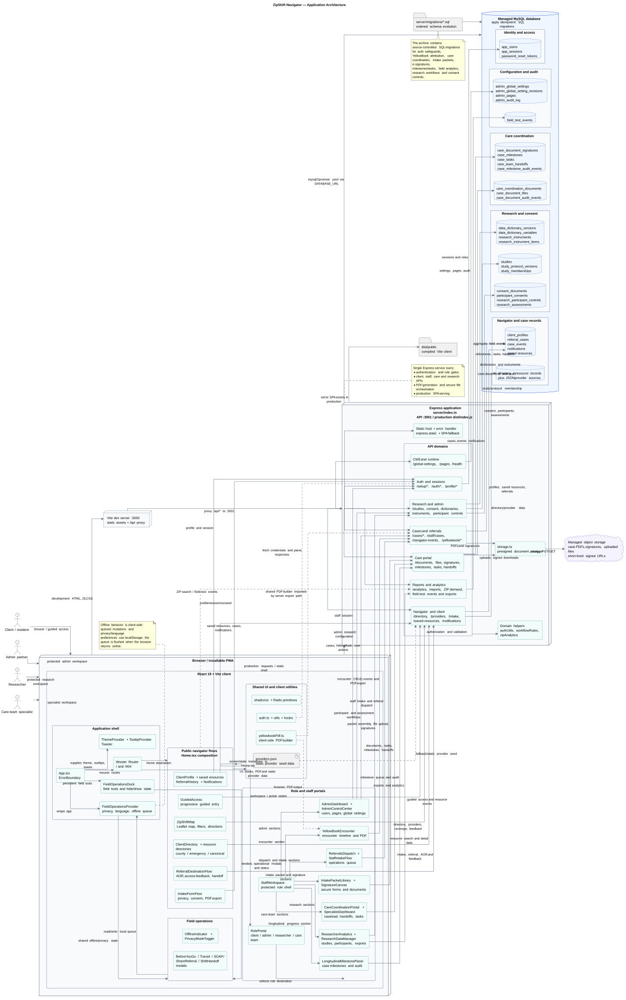
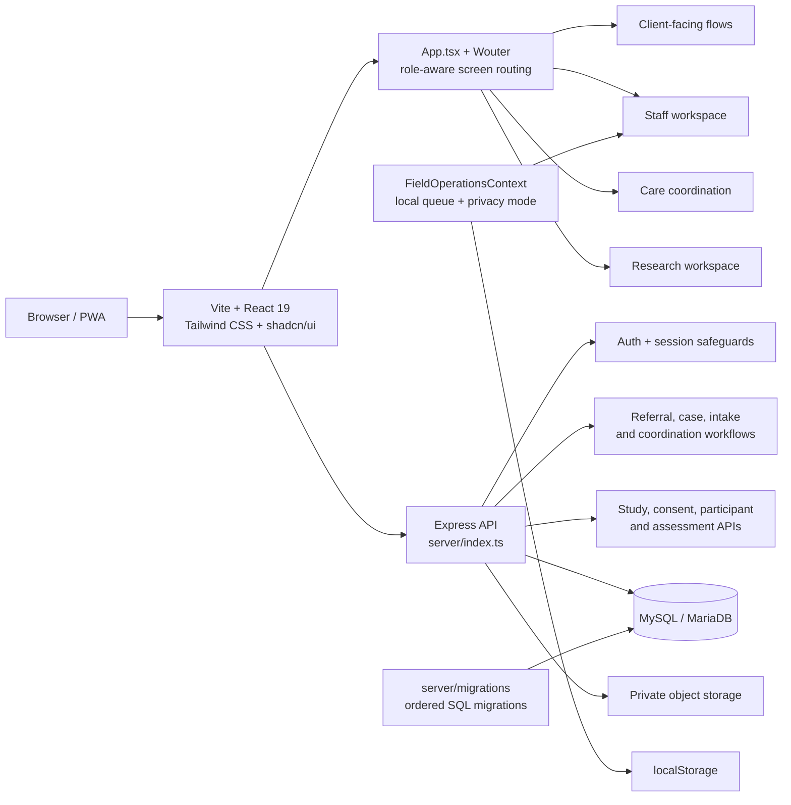
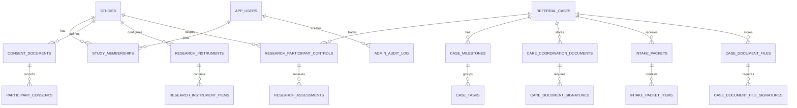
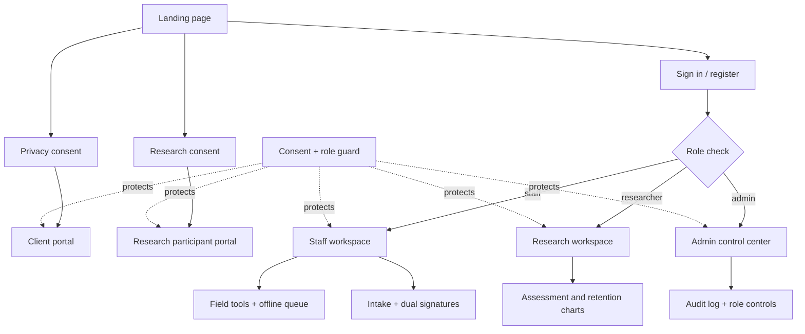

# ZipShift Navigator

ZipShift Navigator is a role-aware community-resource, referral, care-coordination, and research workflow PWA. It combines a React 19 client with an Express API, MySQL/MariaDB persistence, incremental SQL migrations, private document storage, consent and role safeguards, field operations tooling, research configuration, and printable resource workflows.

The application is designed for teams that need to move from resource discovery to referral follow-up without losing privacy, auditability, accessibility, or study-specific controls. Client-facing screens, staff workflows, researcher tools, and admin controls share the same visual system and route shell.

## Documentation and implementation map

Use this table of contents to find the architecture diagrams, API contract, migration plan, implementation code, and test coverage from the application landing page.

| Area | Primary links | Implementation pointers |
| --- | --- | --- |
| Getting started | [Local development](#local-development), [API surface](#api-surface) | [`package.json`](package.json), [`vitest.config.ts`](vitest.config.ts) |
| Architecture | [PlantUML source](docs/zipshift-architecture.puml), [SVG architecture export](docs/zipshift-architecture.svg), [Mermaid architecture](docs/architecture.mmd) | [`server/index.ts`](server/index.ts), [`server/db/dualDatabase.ts`](server/db/dualDatabase.ts) |
| API and data model | [API reference](docs/API.md), [data-model/API review](docs/data-model-and-api-review.md), [database schema](docs/database-schema.mmd) | [`server/caseEvents.ts`](server/caseEvents.ts), [`server/pagination.ts`](server/pagination.ts) |
| Performance and security | [Implementation plan](docs/performance-security-compliance-implementation-plan.md), [security/user journeys](docs/user-journeys.mmd) | [`server/db/transactions.ts`](server/db/transactions.ts), [`server/pagination.test.ts`](server/pagination.test.ts), [`server/db/transactions.test.ts`](server/db/transactions.test.ts) |
| Database migrations | [Migration strategy](docs/DUAL_DATABASE_MIGRATION.md), [migration guide](server/migrations/README.md) | [`server/migrations/20261019_add_cursor_indexes_and_event_idempotency.sql`](server/migrations/20261019_add_cursor_indexes_and_event_idempotency.sql), [`scripts/migrate-cursor-indexes.ts`](scripts/migrate-cursor-indexes.ts), [`scripts/translate-mysql-migrations.ts`](scripts/translate-mysql-migrations.ts) |
| Security-hardened events | [API event contract](docs/API.md#case-and-notification-endpoints), [implementation plan](docs/performance-security-compliance-implementation-plan.md#5-apievents-hardening-plan) | [`/api/events`](server/index.ts), [`server/caseEvents.ts`](server/caseEvents.ts), [`server/caseEvents.test.ts`](server/caseEvents.test.ts) |
| Test coverage | [Contribution and validation guidance](.github/CONTRIBUTING.md) | [`server/api.integration.test.ts`](server/api.integration.test.ts), [`server/pagination.db.integration.test.ts`](server/pagination.db.integration.test.ts), [`server/db/dualDatabase.test.ts`](server/db/dualDatabase.test.ts) |

The documentation index is [`docs/README.md`](docs/README.md). The implementation proposal includes composite-index SQL, signed cursor pagination, `/api/events` authorization and idempotency, transaction patterns, research/compliance controls, and the FHIR-ready schema plan.

## Featured PlantUML architecture

[](docs/zipshift-architecture.svg)

The diagram above is the canonical large-scale system map. It shows how the React/Vite PWA, Express API domains, MySQL data groups, private object storage, ordered migrations, and runtime assets fit together. The editable source is [`docs/zipshift-architecture.puml`](docs/zipshift-architecture.puml); the SVG is committed so the architecture can be reviewed directly in GitHub without a local PlantUML installation.

The large map is intentionally supported by smaller diagrams, each focused on one boundary:

| Focus | What it explains | PlantUML source | Rendered SVG |
| --- | --- | --- | --- |
| Client | React shell, public navigator flows, role portals, offline field operations, and local storage | [`01-client-architecture.puml`](docs/plantuml/01-client-architecture.puml) | [`01-client-architecture.svg`](docs/plantuml/01-client-architecture.svg) |
| API domains | Express route groups, authorization guards, cursor pagination, transactions, storage, and database boundaries | [`02-api-domain-architecture.puml`](docs/plantuml/02-api-domain-architecture.puml) | [`02-api-domain-architecture.svg`](docs/plantuml/02-api-domain-architecture.svg) |
| Data | Identity, cases, care coordination, research, audit, event idempotency, and keyset-pagination relationships | [`03-data-architecture.puml`](docs/plantuml/03-data-architecture.puml) | [`03-data-architecture.svg`](docs/plantuml/03-data-architecture.svg) |
| Security and events | Authenticated `/api/events` lifecycle, validation, case access, idempotency, commit, and rollback behavior | [`04-security-event-flow.puml`](docs/plantuml/04-security-event-flow.puml) | [`04-security-event-flow.svg`](docs/plantuml/04-security-event-flow.svg) |
| Runtime and deployment | Development proxy, production Express/static serving, database, object storage, migrations, and build outputs | [`05-runtime-deployment.puml`](docs/plantuml/05-runtime-deployment.puml) | [`05-runtime-deployment.svg`](docs/plantuml/05-runtime-deployment.svg) |

Read the large diagram from the outside in: actors enter through the browser, the client routes work into Express domain APIs, cross-cutting guards protect the request, and domain services persist to grouped data tables or private object storage. Then use the focused views when reviewing a specific implementation boundary or planning a change.

## Current verification status

This repository includes the field-tools visibility update. The floating Field tools dock now has bilingual accessible Hide and Show controls, persists its visibility preference in `localStorage`, and closes open field panels when hidden.

| Check | Result |
| --- | --- |
| Dependency installation | `pnpm install --frozen-lockfile` passed |
| TypeScript | `pnpm run check` passed |
| Automated tests | 53 passed, 3 skipped across 16 test files |
| Production build | `pnpm run build` passed |
| Static preview | HTTP 200 for `/` and `/__manus__/version.json` |

The combined local API preview and the optional database load/integration tests require MySQL/MariaDB. In the source-validation environment no local database was running, so those three database-dependent tests were skipped while the frontend, production build, compiler, unit tests, cursor stress fixture, and migration dry-run were verified independently.

## Product capabilities

### Client and community-resource experience

- Localized resource discovery and directory browsing.
- Search, saved resources, referral handoff, and branded printable guides.
- QR codes and last-verified dates on provider cards.
- Privacy and research consent entry points with role-aware routing.
- Emergency, county, and specialized resource directories.

### Staff and field operations

- Staff workspace for referrals, cases, YellowBook encounters, reports, notifications, and audit events.
- Floating field-tools dock for notifications, preparation checklists, transit, capacity reports, referral sharing, SOAP notes, and shift handoffs.
- Offline mutation queue and online synchronization behavior.
- Privacy mode for minimum-necessary display and bilingual labels.
- Persistent session indicators and authorized workspace switching.
- Field-tools Hide/Show control with local persistence.

### Care coordination and intake

- Case-scoped care portal for documents, milestones, tasks, handoffs, and queues.
- Selectable intake packet forms.
- Client/staff signature capture with stored integrity metadata.
- Document audit events and role-aware access boundaries.

### Research and administration

- Study, protocol, membership, consent-document, and participant-control workflows.
- Data Dictionary Manager for study-specific variables and versions.
- Research instruments, instrument items, scoring rules, assessments, and retention tracking.
- Participant completion and retention trend charts with high-resolution export.
- Consent expiry and unanswered safety-item reminder workflows.
- Admin pages, global settings, revision history, user controls, and audit logging.

## Architecture



The full editable diagram is [`docs/architecture.mmd`](docs/architecture.mmd).

## Data model

The database is evolved through ordered SQL migrations in `server/migrations/`. The core domains are identity and authorization, referral cases, study and consent management, configurable research instruments, care coordination documents, intake packets, milestones and tasks, field analytics, and administrative audit history.



The expanded entity diagram with key fields and foreign-key relationships is [`docs/database-schema.mmd`](docs/database-schema.mmd).

## User and security flows



The complete editable flow is [`docs/user-journeys.mmd`](docs/user-journeys.mmd).

## Repository structure

```text
client/
  index.html                 Browser entry document and metadata
  public/                    Small public runtime assets and debug helpers
  src/
    App.tsx                  Top-level provider and route shell
    main.tsx                 React bootstrap
    pages/                   Page-level screens
    components/              Product workflows and reusable UI
      field/                 Offline-aware field-tools dock and modals
      ui/                    shadcn/Radix-style primitives
    contexts/                Theme and shared client contexts
    data/                    Curated provider/resource data
    hooks/                   Reusable client hooks
    lib/                     Auth, PDF, coverage, and testable utilities
    index.css                Global design tokens and Tailwind layers
server/
  index.ts                   Express server and API route composition
  authUtils.ts               Authentication and session helpers
  storage.ts                 Private object-storage helpers
  workflowRules.ts           Referral/workflow rules
  zipAnalytics.ts            Search and field analytics
  data/                      Directory and regional resource datasets
  migrations/                Ordered MySQL/MariaDB schema migrations
shared/
  const.ts                   Shared constants
  referralFlow.ts            Shared referral state rules
docs/
  *.mmd                      Mermaid architecture, data, and journey diagrams
  *.md                       Product, workflow, and source notes
patches/                     Package-manager patch files
vite.config.ts               Vite client build configuration
vitest.config.ts             Test configuration
package.json                 Scripts and dependencies
pnpm-lock.yaml               Reproducible dependency lockfile
```

## Local development

Requirements are Node.js, pnpm 10.x, and MySQL/MariaDB for API-backed flows. Install dependencies and run the checks:

```bash
pnpm install --frozen-lockfile
pnpm run check
pnpm test
pnpm run build
```

Start the combined development environment with `pnpm run dev`. The Vite client serves the frontend while the Express API listens on the configured application port. For a frontend-only production preview after building:

```bash
pnpm run preview -- --host 0.0.0.0 --port 4173
```

Use environment variables for database and storage configuration. Never commit credentials, session secrets, signed URLs, private PDFs, or production data. Apply migrations in filename order using the deployment process before enabling a new workflow in production.

## API surface

The Express server groups endpoints by capability: `/api/auth/*`, `/api/profile`, `/api/directory`, `/api/resources/*`, `/api/analytics/*`, `/api/intake`, `/api/cases/*`, `/api/staff/*`, `/api/care-portal/*`, `/api/admin/*`, `/api/research/*`, `/api/profile/consents`, and `/api/pages/*`. `/api/health` is the unauthenticated health probe.

Authorization is enforced at the API boundary in addition to client-side route visibility. Consent, role, study membership, case ownership/team access, and audit requirements must be preserved when adding new screens or endpoints.

## Design principles

ZipShift uses a shared dark navy and teal product language with compact rounded controls, restrained borders, readable metadata, and high-contrast status accents. The application favors task-oriented panels over decorative pages, keeps client and staff experiences in the same shell, and treats accessibility, localization, minimum-necessary data display, and offline resilience as product behavior rather than optional polish.

## License and data handling

The repository is licensed under MIT as indicated by `package.json`. The software is a workflow implementation, not medical advice and not a substitute for local clinical, legal, privacy, or research governance review. Configure deployment privacy, retention, consent, storage, and access policies for the operating organization before using real client or participant data.
