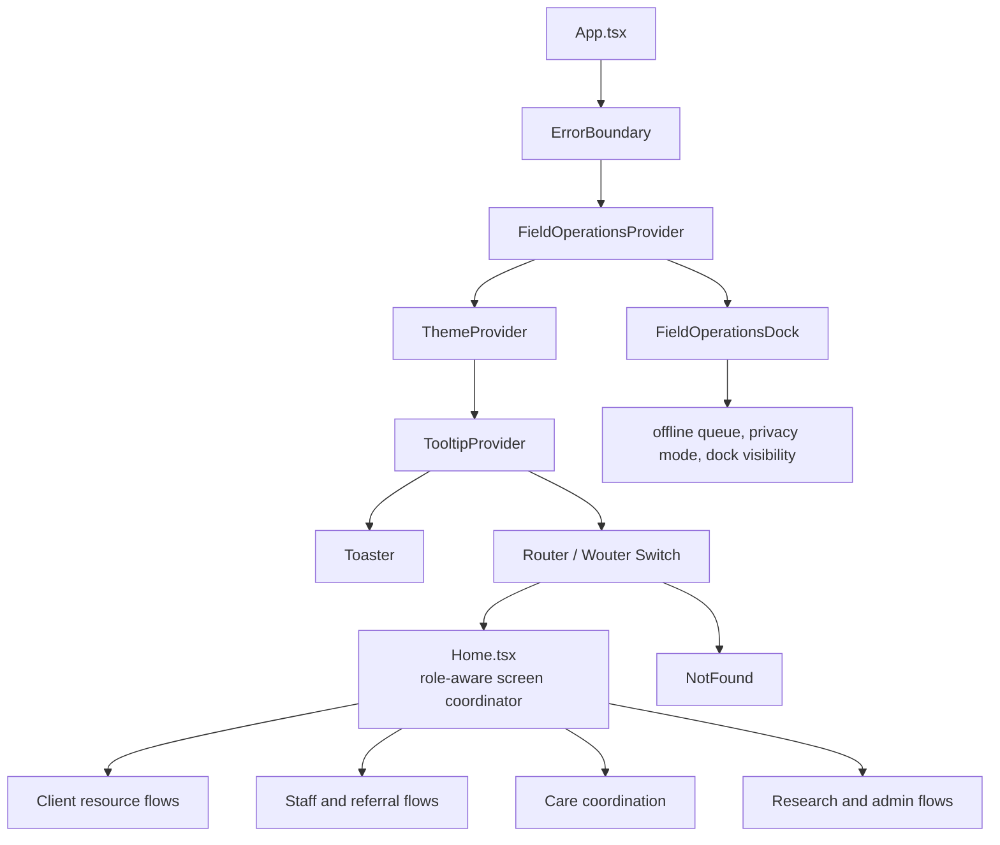

# ZipShift Navigator Component Hierarchy

This document describes the current React component composition and the intended ownership boundaries between the application shell, product workflows, field operations, shared UI primitives, and server-backed state.

## Top-level composition



`App.tsx` owns global providers and the route boundary. `Home.tsx` is currently the product shell and screen coordinator rather than a simple landing page: it owns the screen union, client session context, resource data, workspace switching, and composition of the major workflow panels. New work should extend existing domain components instead of creating another top-level shell.

## Domain hierarchy

```text
App
├── ErrorBoundary
├── FieldOperationsProvider
│   └── FieldOperationsDock
│       ├── NotificationPanel
│       ├── OfflineIndicator
│       ├── PrivacyModeToggle
│       ├── BeforeYouGoModal
│       ├── CapacityReportModal
│       ├── TransitPanel
│       ├── ShareReferralModal
│       ├── SOAPNoteModal
│       └── ShiftHandoffModal
├── ThemeProvider
├── TooltipProvider
├── Toaster
└── Router
    ├── Home
    │   ├── ZipShiftMap
    │   ├── ClientDirectory
    │   ├── CountyResourceDirectory
    │   ├── EmergencyResourceDirectory
    │   ├── ClientQuickGuideModal
    │   ├── ReferralDestinationFlow
    │   ├── ReferralHistory
    │   ├── ClientProfile
    │   ├── GuidedAccess
    │   ├── NotificationCenter
    │   ├── IntakeFormFlow
    │   ├── RolePortal
    │   ├── StaffWorkspace
    │   │   ├── YellowBookEncounter
    │   │   │   ├── PatientSummaryCard
    │   │   │   └── PatientActivityTimeline
    │   │   ├── AdminControlCenter
    │   │   │   └── StudyConsentManager
    │   │   └── ReferralsDispatch
    │   ├── StaffIntakeFlow
    │   ├── CareCoordinationPortal
    │   │   ├── IntakePacketLibrary
    │   │   │   └── SignatureCanvas
    │   │   └── LongitudinalMilestonePanel
    │   ├── SpecialistDashboard
    │   ├── AdminDashboard
    │   │   └── StaffWorkspace
    │   └── ResearcherAnalytics
    │       └── StaffWorkspace
    └── NotFound
```

## Responsibilities by layer

### Application shell

- `App.tsx`: global providers, error boundary, router, field dock mounting.
- `ThemeContext.tsx`: theme state and design-token mode.
- `Home.tsx`: current screen coordinator and role/workspace composition.
- `NotFound.tsx`: fallback route.
- `ErrorBoundary.tsx`: defensive rendering boundary for unexpected client errors.

The shell may decide which screen to show, but it must not replace server authorization. A hidden client panel is not a permission check.

### Client resource flows

- `ZipShiftMap`: map and geographic resource presentation.
- `ClientDirectory`: searchable provider/resource directory.
- `CountyResourceDirectory` and `EmergencyResourceDirectory`: focused resource directories.
- `ClientQuickGuideModal`: branded printable resource guidance.
- `ReferralDestinationFlow`: referral destination selection and next-step flow.
- `ReferralHistory`: client-visible referral history.
- `ClientProfile`: profile, consent, and user-facing account controls.
- `GuidedAccess`: guided entry/accessibility-oriented navigation.

These components should keep provider display minimum-necessary and should use stable directory IDs instead of copying sensitive data into local analytics events.

### Staff and referral flows

- `RolePortal`: role selection and workspace entry.
- `StaffWorkspace`: staff case/referral hub and specialist composition.
- `ReferralsDispatch`: referral dispatch and destination operations.
- `StaffIntakeFlow`: staff-side intake workflow.
- `YellowBookEncounter`: encounter editing, summary, and timeline composition.
- `PatientSummaryCard`: compact case/patient context presentation.
- `PatientActivityTimeline`: chronological activity presentation.
- `NotificationCenter`: staff/client notification presentation.

Staff components should keep session context visible, preserve workspace switching behavior, and rely on API authorization for case access.

### Care coordination

- `CareCoordinationPortal`: case-scoped coordination workspace.
- `IntakePacketLibrary`: packet-form selection and packet assembly.
- `SignatureCanvas`: signature capture UI; server endpoints remain responsible for signature integrity metadata and authorization.
- `LongitudinalMilestonePanel`: milestones, due dates, completion state, and task-adjacent timeline behavior.

Document upload/download, signature, milestone, task, and handoff operations belong to the care-portal API boundary documented in [`API.md`](API.md).

### Research and administration

- `ResearcherAnalytics`: study participant completion, retention trends, and export controls.
- `ResearchDataManager`: research configuration and data management surface.
- `StudyConsentManager`: protocol, consent-document, and study-level configuration.
- `AdminControlCenter`: administrative composition boundary.
- `AdminDashboard`: high-level admin/staff dashboard composition.
- `SpecialistDashboard`: specialist-oriented case view.

Research components must preserve study membership, consent, withdrawal, retention, and export constraints. Configuration components should distinguish editable configuration from participant data.

## Field operations state boundary

`FieldOperationsProvider` owns cross-cutting field state, including:

- Field-tool panel state.
- Persistent dock visibility preference.
- Privacy mode.
- Online/offline status.
- Queueable field mutations and synchronization state.
- Bilingual field-tool labels and accessible control state.

`FieldOperationsDock` is the mounted visual boundary. Individual panels should remain focused on one task and consume the context rather than duplicating queue or privacy logic. The Hide/Show control belongs to the dock boundary so it can close panels consistently and persist the user preference.

## Shared UI primitives

`client/src/components/ui/` contains Radix/shadcn-style primitives such as `Button`, `Dialog`, `Sheet`, `Popover`, `Tabs`, `Table`, `Tooltip`, `Sidebar`, `Input`, `Textarea`, and `Form`. Product components should compose these primitives and preserve their focus, keyboard, and variant behavior. Changes to a primitive can affect every role flow, so include broad visual and interaction checks in the pull request.

## State and data ownership

| Concern | Preferred owner |
| --- | --- |
| Global theme | `ThemeProvider` |
| Current screen/workspace | `Home.tsx` until the route shell is decomposed |
| Field queue, privacy mode, dock visibility | `FieldOperationsProvider` |
| Provider/resource datasets | curated data modules and server directory endpoints |
| Authentication/session truth | server auth endpoints and session state |
| Case/study authorization | Express API guards and database relationships |
| Signed file access | server storage helpers and short-lived signed URLs |
| UI-only modal open state | owning feature component |
| Shared design primitives | `client/src/components/ui/` |

## Extension guidelines

When adding a feature, identify its domain owner first. Add a focused component under the matching domain, compose it from existing primitives, and connect it to the smallest appropriate screen boundary. If the feature needs server data, add or update the API reference and tests in the same change. If it changes schema, add an ordered migration and document retention/access implications.
